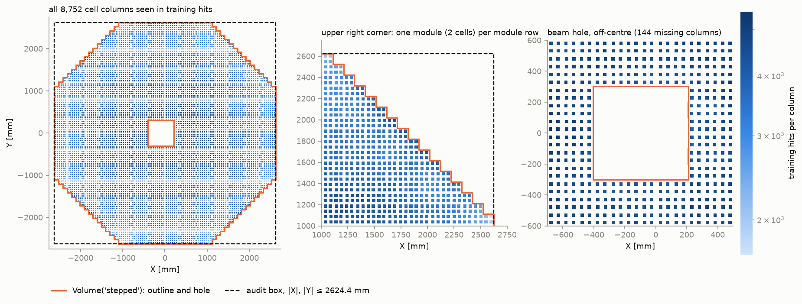
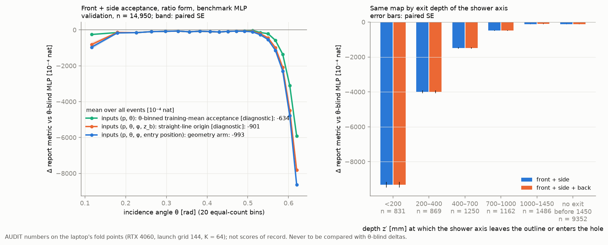

# Geometry audit for the zero-training 3-D acceptance arm

*25 Nov 2026. Scope: PLAN §14, user decision on the geometry-conditioned arm. Data: training split for sections 1–3,
validation split for section 4. The test split was not opened; the raw table was read through a filter on the
training and validation event numbers (details and the first session's access in section 6). No training, no
registry row.*

*Every likelihood number in this report is an **audit number**: computed on this laptop (RTX 4060, launch grid 144)
on the fold points of `common.test_nll` (K = 64, seed 12345, batches of 128), with the frozen benchmark MLP
(`mlp_std`) and the component formula standing in for the θ-blind finalists, which are not frozen yet. They decide
whether and in which form the arm is run. Scores of record are produced later on the H200. Unit: 10⁻⁴ nat per
event, mean ± paired standard error over events, unless stated otherwise. Inputs of every geometry-aware map:
(p, θ, φ, entry position); none of these numbers may be compared with a θ-blind delta.*

## 1. The instrumented volume (training hits)

Source: all 34,326,739 rows of the 69,783 training events (no time or fiducial cut), global coordinates `x, y, z`.

**Layers.** 60 layers, centres 3662.4 + 20.5·k mm (deviation ≤ 10⁻⁴ mm); front face 3652.15 mm, back face
4882.15 mm. No row lies on another z.

**Lattice.** 8,752 distinct (x, y) columns in 104 cell rows. Rows come in pairs (modules 101 mm high: y = 101·m +
{26.2, 74.8} mm); inside a row the tower pitch is 48.27 mm within a module (46.07 mm in the narrow two-tower modules) and 57.08 or
58.97 mm across a module boundary. The lattice is mirror-symmetric about Y = 0 and about X = +2.5 mm (first + last column centre = 5.000 mm
in every row). It is not a uniform 48.6 mm grid.

**Outline: a stepped octagon.** The 11 innermost module rows per side (|Y| < 1111 mm) are full width (104 cells,
outermost centres at X = −2594.5 / +2599.5 or −2596.0 / +2601.0 mm, alternating by module row). Each further module
row is one module (two cells, 100.944 mm) narrower on each side: 100, 96, …, 44 cells, down to |X − 2.5| ≤ 1082.8 mm
(centres) in the outermost rows |Y| = 2551.2 / 2599.8 mm.

**Beam hole, off-centre.** In the three innermost module rows per side (12 cell rows, |Y| ≤ 276.8 mm) the columns
between X = −430.8 and +233.9 mm (rows a = 0, 2) or −429.5 and +231.8 mm (row a = 1) are missing: 144 columns. With
a half cell of 24.3 mm the free aperture is X ∈ (−406.5, +209.6) mm, |Y| < 303 mm, centred at X ≈ −98 mm.

**No depth dependence.** 525,101 of the 8,752 × 60 = 525,120 cells are hit. The 19 never-hit cells are in layers
58 (2) and 59 (17), scattered over the face. A Poisson expectation built from the neighbouring columns of the same
layer predicts 24.6 ± 4.9 empty cells (4.0 in layer 58, 18.8 in layer 59): they are low-occupancy cells, not holes.

**Evidence that the outline is complete.** All 8,752 columns have been seen after the first 726 training events;
the cell count saturates (figure `figures/saturation.png`: 510,850 cells after 10,000 events, 525,018 after 50,000,
22 new cells in the last 10,000 events, all in layers 56–59). Every column has at least 1,692 training hits.
Pile-up test: the outermost column of a row holds 1.04 times the hits of its inner neighbour (median over the 104
rows; range 0.80–1.16), against 1.03 for the next pair; at the hole 0.95 against 0.97; the top and bottom cell rows
1.03 times the next row. An edge produced by clipping coordinates would collect the clipped hits in the edge cells.
No row lies beyond max |X| = 2601.035, max |Y| = 2599.800 mm.



**The volume model as code** (`src/sfm/geometry.py`):

```python
X_CENTRE, MODULE_PITCH_Y, HALF_CELL = 2.5, 101.0, 24.3
X_LAST = (2599.461, 2601.035, 2599.461, 2601.035, 2599.461, 2601.035, 2599.461, 2601.035, 2599.461, 2601.035,
          2599.461, 2498.516, 2397.572, 2296.627, 2195.683, 2094.738, 1993.794, 1892.849, 1791.905, 1690.961,
          1590.016, 1489.072, 1388.127, 1287.183, 1186.238, 1085.294)     # outermost cell centre of module row a
Y_MAX = 2599.8 + HALF_CELL
HOLE_LEFT, HOLE_RIGHT, HOLE_Y = (-430.762, -429.465, -430.762), (233.873, 231.815, 233.873), 303.0

def inside_xy(X, Y):                                   # Volume("stepped")
    a = floor(|Y| / 101).clamp(0, 25)
    inside = (|X - 2.5| <= X_LAST[a] - 2.5 + 24.3) & (|Y| <= Y_MAX)
    hole = (|Y| < 303) & (X > HOLE_LEFT[min(a, 2)] + 24.3) & (X < HOLE_RIGHT[min(a, 2)] - 24.3)
    return inside & ~hole
# depth: Z_FRONT = 3652.15 <= Z <= Z_BACK = 4882.15 for every column
```

It is the envelope of the fold boxes (±24.3 mm) of all columns, with the module gaps filled (4.1 % of the area in
X, measured; 3.8 % in Y from the pitch). A uniform loss cancels in a normalised map, so the gaps are not modelled.
`tests/test_geometry.py` checks the constants against the column list and against `columns_inside`, a point test
built directly on the column list (disagreement on 400,000 random points: below 2·10⁻⁵).

| Volume model | training hit centres outside (of 19,423,809 cache hits) | energy share of the fold boxes outside | share of the model's area without cells | share of the instrumented area missing |
|---|---|---|---|---|
| `Volume("stepped")` — final | 0 | 0 | 0 | 0 |
| `Volume("octagon")` — simpler alternative: straight edge through the step midpoints, rectangular hole (9 numbers) | 0 | 0.37 % (109,196 hits partly outside) | 0.35 % | 0.38 % |
| `Volume("box")` — |X|, |Y| ≤ 2624.4 mm, no hole (Milestone 1 audit) | 0 | 0 | **19.2 %** | 0.004 % |

(Also 0 of the 34,326,739 uncut training rows lie outside any of the three.) The hits-outside test cannot see the
defect of the box: the box is too large, by the four corners (17.8 % of its lattice positions) and the hole (1.3 %).

**Remaining uncertainty.** (i) The outline is an envelope of hit cells, known to half a cell; dead material inside
the envelope (module walls) is not resolved beyond the gaps. (ii) The true aperture of the hole and the true outer
boundary lie somewhere inside the 4–10 mm gaps next to the edge cells. (iii) Layers 58–59 are thinly populated
(median 9 and 7 hits per cell), so a missing cell there could not be told from an empty one. (iv) Nothing was
compared with the DD4hep description; this is the geometry as the hits show it.

## 2. Question (a): why 1.35 % of events did not fit the box

**Direct reproduction on the training split** (`g3_box135.py`, 69,783 events, 19,423,809 cache hits). The test of
`c_side.py` puts the frame origin on the straight line from the global origin along (θ, φ) and asks whether a hit
centre lies outside |X|, |Y| ≤ 2624.4 mm.

| Origin used | events with a hit centre outside the box | mean energy share outside |
|---|---|---|
| straight line (as in `c_side.py`) | **951 of 69,783 = 1.363 %** (validation, Milestone 1: 202 of 14,950 = 1.351 %) | 0.463 ± 0.022 % (validation: 0.379 %) |
| true origin (`cache/pion_s1_geometry_trainval.pt`) | **0** (0 hits; max |X| = 2601.03, max |Y| = 2599.80 mm) | 0 |

So the 1.35 % is produced entirely by the origin assumed in the test. It is not the stepped outline, not the beam
hole and not a coordinate edge: with the true coordinates the box contains every hit.

**Cause.** The origin of the shower frame is the energy-weighted centroid of the lowest-z hit layer over all rows
of the event (verified again here on all training events: the centroid equals the origin within 1.8·10⁻¹² mm, 0
exceptions). It differs from the straight-line point by 23 mm in the median, by more than 100 mm in 9.27 % and by
more than 500 mm in 0.89 % of the training events. An edge-cell centre is only 23.4 mm inside the box edge
(2624.4 − 2601.0), so a frame shifted outwards by more than that carries edge hits across it.

- All 951 flagged events have a displacement above 23.4 mm (minimum 24.09 mm), and in each the largest overshoot
  beyond the box edge is smaller than the displacement component. No event with a displacement below 23.4 mm is
  flagged (0 of 35,657).
- By class:

| Class (training events) | events | flagged | share of the 951 | share of the energy outside |
|---|---|---|---|---|
| first layer hit (k = 0), origin displaced 23.4–100 mm: cell-centre quantisation and centroid pull | 26,732 | 556 | 58.5 % | 46.7 % |
| k = 0, displaced > 100 mm: centroid dominated by stray or late first-layer deposits (median first-layer rms radius 135 mm against 33 mm; 16.6 % of the first-layer energy later than 100 ns against 1.9 %) | 5,926 | 345 | 36.3 % | 43.0 % |
| late start (first hit layer k ≥ 1) | 1,878 | 50 | 5.3 % | 10.3 % |
| k = 0, displaced < 23.4 mm | 35,247 | 0 | 0 | 0 |

- The flagged events are large-angle events near the outline (median θ 0.597 rad against 0.444 rad); none of them
  enters through the beam hole (0 of the 678 events whose nominal entry point lies in the aperture).
- The box test was blind to the real defects: with the straight-line origin and the correct outline, 4,187 training
  events (6.0 %) have a hit centre "outside" (corners, hole), and with the true origin none has.

**Consequence for the arm.** The entry position that the arm uses must be the frame origin of the event (shipped in
`cache/pion_s1_geometry_trainval.pt`), not a straight-line reconstruction from (θ, φ, z_b); section 4 measures what
the difference costs.

## 3. Per-event acceptance

**Definition.** For event e with rotation R_e, origin O_e and a set of faces F, the acceptance of the grid cell c
of the (z′, r) map is the fraction of the cell's ring volume that lies inside the faces:

    A_e(c) = (1 / |c|) ∫_c dz′ d(r²) (1 / 2π) ∫ dα  1[ O_e + R_eᵀ (r cos α, r sin α, z′) ∈ F ]

- **front**: Z ≥ Z(O_e) − 10.25 mm, the plane half a layer in front of the first *hit* layer — the plane of the
  legacy `event_slab`. By the definition of the origin no hit of the event can lie in front of it; for the 97.3 %
  of events whose first layer is hit it is the detector front face (3652.15 mm).
- **side**: (X, Y) inside `Volume("stepped")` (outline and hole).
- **back**: Z ≤ 4882.15 mm. In the shower frame this plane is tilted; the metric's z_b is its depth on the axis.

Three face sets are used: front (F), front + side (FS), front + side + back (FSB); front + back (FB) is the
per-event version of the stored template `abar`. Quadrature: 2 mid-points in z′ and 2 equal-area sub-rings in r per
grid cell (the sub-points of `slab_accept`) and 64 equidistant azimuths. Code: `sfm.geometry.acceptance`.

**Checks (4,096 randomly drawn training events; `g4_acceptance.py`, `g4b_montecarlo.py`).**

| Check | Result |
|---|---|
| Quadrature convergence of A against (4 sub-points, 512 azimuths), 256 events | (2, 64): mean \|ΔA\| 0.0006 (F), 0.0014 (FS), 0.0015 (FSB); maximum 0.25 in single cells (two sub-points across a face that cuts a cell). (4, 128): mean 0.0001–0.0004, maximum 0.010 |
| Same at the level of the NLL (MLP × A, 4,096 events) | (2, 64) minus (4, 256): −0.03 ± 0.07 (F), −0.04 ± 0.10 (FS), −0.09 ± 0.11 (FSB) ×10⁻⁴ nat; (2, 32) minus (4, 256): +0.30 ± 0.10, +0.16 ± 0.19, +0.16 ± 0.20 |
| Numeric front against the closed form of the legacy code (`legacy.C["event_slab"](front=True, back=False)`, same sub-points) | max \|ΔA\| 0.0148, mean \|ΔA\| 0.00048, mean ΔA −4.8·10⁻⁶; NLL of MLP × A: numeric − closed form = −0.06 ± 0.04 ×10⁻⁴ nat. Front + back against `event_slab(front, back)`: max 0.0152, mean 0.00084; −0.07 ± 0.04 |
| Monte Carlo, 48 events (24 side-leaking), 256 random points per cell, point test `columns_inside` (built on the column list, independent of the outline constants) | FS: quadrature − MC = −1.8·10⁻⁵ ± 3.9·10⁻⁵ (mean over 196,608 cells); rms 0.0173 against 0.0170 expected from the binomial noise alone; largest difference of an event-mean acceptance 0.0008. FSB: −1.7·10⁻⁵ ± 4.0·10⁻⁵, rms 0.0176 against 0.0172 |
| Fold points in cells with A = 0 | 3.1·10⁻⁵ (FS) and 3.5·10⁻⁵ (FSB) of the energy-weighted fold points; no hit centre, and no hit with all 64 points in such cells |
| Acceptance floor (cells with A below the floor are set to it), scan on the 4,096 training events, MLP × A_FS | gain −961.5 (floor 10⁻⁶), −961.2 (10⁻⁴), −959.2 (10⁻³), −938.6 (10⁻²), −757.4 ± 36 (10⁻¹), the others ± 44–46: flat below 10⁻³. **Floor 10⁻³ is used**, the order of the quadrature resolution (1/256); it was fixed before validation was scored |

**How the acceptance enters a map** (`sfm.geometry.apply_acceptance`). Two parameter-free forms were compared on
the 4,096 training events before validation was scored (`g4c_forms.py`):

    naive   log P_e = log_softmax( log P + ln max(A_e, f) )
    ratio   log P_e = log_softmax( log P + ln max(A_e, f) − ln max(Ā, f) ),   Ā(z′, r) = mean of A_e over the 69,783 training events

Ā is pure geometry (θ, φ and origin of the training events, same faces as A_e; `arrays/abar_train.npz`); no hit and
no fit enters, and it is not a function of p. The floor is f = 10⁻³ in both. Reason for the ratio form: a θ-blind
map was fitted to event-averaged data and therefore already contains the mean acceptance; multiplying it by A_e
counts that mean twice. The component formula carries the stored template `abar` (front + back) explicitly, but its
core has absorbed the mean side acceptance in the same way.

| Training subsample, Δ against the map's own base | front | front + back | front + side | all faces |
|---|---|---|---|---|
| MLP × A_e (naive) | +63.7 ± 8.8 | +77.0 ± 9.6 | −959.2 ± 45.4 | −943.0 ± 45.6 |
| MLP × A_e / Ā (ratio) | +2.4 ± 2.3 | +16.5 ± 4.3 | −1066.0 ± 44.6 | −1069.5 ± 45.0 |
| formula × A_e / Ā (ratio) | +0.8 ± 2.3 | +17.5 ± 4.3 | −1062.0 ± 44.2 | −1065.0 ± 44.6 |
| core of the formula × A_e (stored template replaced) | +11.1 ± 3.7 | +17.8 ± 4.3 | −982.3 ± 44.1 | −970.1 ± 44.2 |

Ratio − naive (MLP, paired): −106.9 ± 11.1 (front + side), −126.4 ± 14.3 (all faces). **The ratio form was fixed as
the primary form on this evidence**; the naive form and the core variant are carried along as labelled
alternatives. The floor was scanned for the ratio form as well: −1068.3 (10⁻⁴), −1066.0 (10⁻³), −1043.9 (10⁻²),
−848.3 (10⁻¹) for front + side.

## 4. Question (b): the gain on validation

Setup (`g5_gains.py`, `g5k_gk.py`, `g5c_controls.py`, `g5r_region.py`, `g6_tables.py`): 14,950 validation events; maps
`mlp` = frozen benchmark MLP, `formula` = component formula (core × stored `abar`), `core` = its core alone; these
stand in for the θ-blind finalists. `X*F`, `X*FB`, `X*FS`, `X*FSB` = naive form with front, front + back,
front + side, all faces; `…/abar` = ratio form. Fold points of `common.test_nll`; the base maps reproduce
`common.test_nll` inside `sfm.metric.deterministic()` bit for bit (`g5p_parity.json`; the stored Gate 0 arrays were
written outside that context and differ by at most 2.7·10⁻⁵ per event, 7·10⁻⁸ on the mean). Base values on these
points: MLP 18.117857, formula 18.120061.

### 4.1 Answer

| Validation, audit numbers, 10⁻⁴ nat, Δ against the map's own θ-blind base | MLP, ratio form | formula, ratio form |
|---|---|---|
| **Report metric**, front + side acceptance (n = 14,950) | **−993.3 ± 21.8** | **−989.9 ± 21.6** |
| Report metric, front + side + back (n = 14,950) | −993.7 ± 22.0 | −990.0 ± 21.8 |
| Back-face share = all faces − (front + side), paired | −0.4 ± 2.3 | −0.2 ± 2.3 |
| Report metric, front only | −2.1 ± 1.3 | −3.8 ± 1.3 |
| Report metric, front + back | +11.3 ± 2.1 | +12.1 ± 2.1 |

| Bulk-restricted (G-bulk, PLAN A4: stratum z_b ≥ 1221 mm, z′ < 1150 mm, no last ring; n = 14,784), 10⁻⁴ nat | MLP, ratio form | formula, ratio form |
|---|---|---|
| **G-bulk**, front + side | **−947.7 ± 21.6** | **−942.8 ± 21.4** |
| G-bulk, front + side + back | −948.5 ± 21.6 | −943.6 ± 21.4 |
| G-bulk, all faces − (front + side), paired | −0.8 ± 0.1 | −0.8 ± 0.1 |

| Persistence margin of PLAN §13: Δ(G-bulk) − 0.5·Δ(report metric) on the same 14,784 events, paired SE | MLP, ratio form | formula, ratio form |
|---|---|---|
| front + side | −455.3 ± 10.7 (z = −42.7): pass, resolved | −452.1 ± 10.5 (z = −42.9): pass, resolved |
| front + side + back | −453.5 ± 10.7 (z = −42.4): pass, resolved | −450.5 ± 10.6 (z = −42.5): pass, resolved |

**The gain persists under G-bulk** (the bulk-restricted gain is 96 % of the report-metric gain of the same events,
−947.7 against −984.8) **and with a front + side-only acceptance** (it is the same number with and without the back
face: the back face adds −0.4 ± 2.3). **It is not inflated by the flat z_b cut.** The cut works in the other
direction, see 4.2. The event bootstrap (2,000 replicates, stratified by momentum bin) gives the same errors:
MLP front + side −993.3, 95 % interval −1036 … −952.

The gain is an acceptance gain, not a shape gain: it measures how much of a θ-blind map lies where the detector of
this event is not. It is about 45 times the formula − MLP difference (+22.0 ± 2.9) and must never be set beside a
θ-blind delta. The two stand-in finalists keep their order inside the arm: formula − MLP = +25.5 ± 2.9 (front +
side), +25.7 ± 2.9 (all faces).

### 4.2 Why the flat z_b cut cannot inflate a multiplicative acceptance

Let the event's map be P_e = P·φ / S with a factor φ ≥ 0 (φ = A_e, or A_e/Ā) and S = Σ_c P_c φ_c. The report metric
is NLL_e = −Σ_i w_i ln ĝ_i + ln M_e with M_e the mass in front of z_b. S cancels between the two terms, hence

    Δ_e = NLL_e(P_e) − NLL_e(P) = − Σ_i w_i ln( ĝ_i[P φ] / ĝ_i[P] )  +  ln( Σ_{z′<z_b} P_c φ_c / Σ_{z′<z_b} P_c ).

The mass behind z_b does not appear. A factor can therefore gain only (i) by lowering the mass in front of z_b
where the event has no energy, and (ii) by raising the density where it has. What the back face removes behind z_b
earns nothing, while hits behind z_b that sit in partly accepted rings pay ln φ. The exploit of finding 9 needs a
factor that *raises* the density behind z_b. In the naive form φ ≤ 1 everywhere, so this cannot happen. In the
ratio form φ = A_e/Ā exceeds 1 where the event's acceptance is above the training mean, also behind z_b, and the
hits there take that change without a counter-term. This is the only channel through which the flat cut could
inflate the arm, and it was measured directly (`g5r_region.py`: the first term of the identity summed over the
hits of each region, by hit centre; same fold points; the three regions and the mass term add up to Δ within
2·10⁻⁵ per event):

| Validation, report metric, 10⁻⁴ nat, n = 14,950 | hits behind z_b (0.10 % of the energy, 1,461 events) | hits in front of z_b at z′ ≥ 1150 mm or in the last ring (1.35 %) | bulk hits (98.5 %) | mass term | Δ |
|---|---|---|---|---|---|
| MLP, ratio, front + side | **−3.4 ± 0.3** | −40.4 ± 1.8 | −437.5 ± 14.6 | −512.0 ± 31.6 | −993.3 ± 21.8 |
| MLP, ratio, all faces | −0.8 ± 1.4 | −58.7 ± 3.1 | −445.0 ± 14.6 | −489.3 ± 31.6 | −993.7 ± 22.0 |
| formula, ratio, front + side | −3.4 ± 0.3 | −40.4 ± 1.8 | −439.5 ± 14.6 | −506.6 ± 31.3 | −989.9 ± 21.6 |
| formula, ratio, all faces | −0.8 ± 1.4 | −58.7 ± 3.1 | −447.0 ± 14.6 | −483.6 ± 31.4 | −990.0 ± 21.8 |
| MLP, naive, front + side | +0.7 ± 0.2 | +12.4 ± 0.9 | +780.6 ± 14.2 | −1686.8 ± 30.9 | −893.1 ± 22.1 |
| MLP, naive, all faces | +11.6 ± 1.7 | +21.7 ± 1.1 | +782.1 ± 14.2 | −1694.2 ± 30.9 | −878.8 ± 22.2 |

**Of the −993.3 of the primary map, −3.4 ± 0.3 (0.3 %) comes from hits behind z_b** — the whole amount that the flat
cut leaves unpaid. (This table localises the hit term only, as G-region does.)

The measured decomposition shows this. `metric.Parts` splits Δ into the change of the hit term (the whole-grid log
score) and of the normaliser term ln M_e (columns 4 and 5 of table T1); columns 6 and 7 are the two terms of the
identity above.

**Table T1 Report metric, all validation events (n = 14950). Δ against the map's own base; 1e-4 nat**

| map | faces | Δ report metric | Δ hit term | Δ normaliser term | ln(share of the mass in front of z_b kept by the factor) | hit-side term (Δ minus the previous column) | mass beyond z_b: mean (base) | max |
|---|---|---|---|---|---|---|---|---|
| MLP x A_e (naive) | front | +42.6 ± 4.3 | +43.5 ± 4.3 | -0.9 ± 0.3 | -155.2 ± 0.7 | +197.8 ± 4.4 | 0.0031 (0.0031) | 0.979 |
| MLP x A_e (naive) | front + back | +53.9 ± 4.6 | +16.0 ± 7.0 | +37.9 ± 5.0 | -163.8 ± 0.8 | +217.7 ± 4.6 | 0.0004 (0.0031) | 0.217 |
| MLP x A_e (naive) | front + side | -893.1 ± 22.1 | -892.6 ± 22.1 | -0.5 ± 0.3 | -1686.8 ± 30.9 | +793.8 ± 14.3 | 0.0031 (0.0031) | 0.978 |
| MLP x A_e (naive) | front + side + back | -878.8 ± 22.2 | -916.9 ± 22.8 | +38.1 ± 5.0 | -1694.2 ± 30.9 | +815.5 ± 14.4 | 0.0003 (0.0031) | 0.235 |
| MLP x A_e / Abar (ratio) | front | -2.1 ± 1.3 | -2.1 ± 1.3 | -0.0 ± 0.1 | +0.7 ± 0.4 | -2.8 ± 1.4 | 0.0031 (0.0031) | 0.976 |
| MLP x A_e / Abar (ratio) | front + back | +11.3 ± 2.1 | -23.9 ± 5.5 | +35.2 ± 5.1 | +23.6 ± 0.4 | -12.3 ± 2.1 | 0.0006 (0.0031) | 0.208 |
| MLP x A_e / Abar (ratio) | front + side | -993.3 ± 21.8 | -984.4 ± 21.8 | -8.9 ± 0.4 | -512.0 ± 31.6 | -481.3 ± 15.0 | 0.0039 (0.0031) | 0.979 |
| MLP x A_e / Abar (ratio) | front + side + back | -993.7 ± 22.0 | -1022.0 ± 22.6 | +28.2 ± 5.0 | -489.3 ± 31.6 | -504.4 ± 15.4 | 0.0013 (0.0031) | 0.241 |
| formula x A_e (naive; stored template kept) | front | +37.7 ± 4.3 | +38.6 ± 4.3 | -0.9 ± 0.3 | -160.6 ± 0.7 | +198.3 ± 4.4 | 0.0035 (0.0035) | 0.978 |
| formula x A_e (naive; stored template kept) | front + back | +48.1 ± 4.6 | +6.9 ± 6.9 | +41.2 ± 5.0 | -170.3 ± 0.8 | +218.4 ± 4.7 | 0.0004 (0.0035) | 0.228 |
| formula x A_e (naive; stored template kept) | front + side | -892.1 ± 22.0 | -892.1 ± 21.9 | +0.0 ± 0.2 | -1686.1 ± 30.8 | +794.0 ± 14.3 | 0.0035 (0.0035) | 0.977 |
| formula x A_e (naive; stored template kept) | front + side + back | -878.3 ± 22.1 | -919.9 ± 22.6 | +41.6 ± 4.9 | -1694.2 ± 30.8 | +815.9 ± 14.4 | 0.0004 (0.0035) | 0.245 |
| formula x A_e / Abar (ratio) | front | -3.8 ± 1.3 | -3.8 ± 1.3 | +0.0 ± 0.1 | +0.7 ± 0.3 | -4.5 ± 1.4 | 0.0035 (0.0035) | 0.975 |
| formula x A_e / Abar (ratio) | front + back | +12.1 ± 2.1 | -25.4 ± 5.5 | +37.5 ± 5.0 | +25.9 ± 0.4 | -13.8 ± 2.1 | 0.0008 (0.0035) | 0.216 |
| formula x A_e / Abar (ratio) | front + side | -989.9 ± 21.6 | -980.0 ± 21.6 | -9.9 ± 0.4 | -506.6 ± 31.3 | -483.3 ± 15.0 | 0.0044 (0.0035) | 0.978 |
| formula x A_e / Abar (ratio) | front + side + back | -990.0 ± 21.8 | -1016.2 ± 22.4 | +26.2 ± 4.9 | -483.6 ± 31.4 | -506.4 ± 15.4 | 0.0019 (0.0035) | 0.259 |
| core x A_e (template replaced) | front | +7.9 ± 1.8 | +38.6 ± 1.8 | -30.7 ± 0.2 | -777.2 ± 3.9 | +210.7 ± 4.6 | 0.0065 (0.0035) | 0.975 |
| core x A_e (template replaced) | front + back | +12.4 ± 2.1 | -25.0 ± 5.5 | +37.5 ± 5.0 | -792.9 ± 4.0 | +231.0 ± 4.8 | 0.0008 (0.0035) | 0.216 |
| core x A_e (template replaced) | front + side | -903.4 ± 21.5 | -875.8 ± 21.6 | -27.5 ± 0.3 | -2283.9 ± 29.8 | +806.1 ± 14.3 | 0.0062 (0.0035) | 0.975 |
| core x A_e (template replaced) | front + side + back | -893.1 ± 21.6 | -932.2 ± 22.2 | +39.0 ± 5.0 | -2295.7 ± 29.8 | +828.2 ± 14.4 | 0.0006 (0.0035) | 0.241 |

Columns 4 + 5 = column 3, and columns 6 + 7 = column 3 for the MLP and formula rows. For the core rows column 3 is
the difference to the formula of record (core − formula = +574.3 ± 5.8 on its own) and columns 6–7 refer to the
core alone.

For the back face alone (all faces − front + side, ratio form, MLP): hit term −37.6 ± 5.8, normaliser term
+37.2 ± 5.3, sum −0.4 ± 2.3. A whole-grid score would credit the back face with about −38; the report metric takes
it back through M_e. By stratum: −5.1 ± 1.8 on the 14,784 events with z_b ≥ 1221 mm and **+419 ± 134 on the 166
short events** (table T5a): for late starts the back face lowers the density of the hits behind z_b and the removed
mass is not credited.

**Table T5 Back-face share, report metric (all events): paired differences between face sets of the same map family; 1e-4 nat**

| family | Δ(front+side) | Δ(all faces) | back-face share = Δ(all) − Δ(front+side) | Δ(front+back) − Δ(front) | Δ(front+side) / Δ(all) |
|---|---|---|---|---|---|
| MLP x A_e (naive) | -893.1 ± 22.1 | -878.8 ± 22.2 | +14.3 ± 1.8 | +11.4 ± 1.6 | 1.016 |
| MLP x A_e / Abar (ratio) | -993.3 ± 21.8 | -993.7 ± 22.0 | -0.4 ± 2.3 | +13.4 ± 1.6 | 1.000 |
| formula x A_e (naive; stored template kept) | -892.1 ± 22.0 | -878.3 ± 22.1 | +13.8 ± 1.8 | +10.4 ± 1.6 | 1.016 |
| formula x A_e / Abar (ratio) | -989.9 ± 21.6 | -990.0 ± 21.8 | -0.2 ± 2.3 | +15.9 ± 1.6 | 1.000 |
| core x A_e (template replaced) | -903.4 ± 21.5 | -893.1 ± 21.6 | +10.2 ± 1.8 | +4.6 ± 1.6 | 1.011 |

**Table T5a Back-face share by part, report metric: Δ(all faces) − Δ(front + side), paired; 1e-4 nat**

| family | all events | stratum z_b ≥ 1221 mm (n = 14784) | short events (n = 166) | of which hit term (all events) | of which normaliser term (all events) |
|---|---|---|---|---|---|
| MLP x A_e (naive) | +14.3 ± 1.8 | +8.7 ± 0.7 | +514.9 ± 141.8 | -24.2 ± 5.5 | +38.6 ± 5.2 |
| MLP x A_e / Abar (ratio) | -0.4 ± 2.3 | -5.1 ± 1.8 | +419.4 ± 134.4 | -37.6 ± 5.8 | +37.2 ± 5.3 |
| formula x A_e (naive; stored template kept) | +13.8 ± 1.8 | +8.2 ± 0.7 | +515.6 ± 142.0 | -27.8 ± 5.4 | +41.6 ± 5.1 |
| formula x A_e / Abar (ratio) | -0.2 ± 2.3 | -4.9 ± 1.8 | +421.1 ± 134.6 | -36.3 ± 5.7 | +36.1 ± 5.3 |
| core x A_e (template replaced) | +10.2 ± 1.8 | +4.5 ± 0.7 | +517.2 ± 142.1 | -56.3 ± 5.3 | +66.6 ± 5.0 |

### 4.3 G-bulk and the persistence margins

**Table T2 G-bulk (PLAN A4): stratum z_b ≥ 1221 mm, z′ < 1150 mm without the last ring, Bulk(short="raise"); n = 14784. Bulk-restricted numbers only; 1e-4 nat**

| map | faces | Δ G-bulk | Δ hit term (bulk) | Δ normaliser term (bulk) |
|---|---|---|---|---|
| MLP x A_e (naive) | front | +43.6 ± 4.3 | +43.9 ± 4.3 | -0.3 ± 0.0 |
| MLP x A_e (naive) | front + back | +43.4 ± 4.3 | +18.8 ± 4.4 | +24.6 ± 0.2 |
| MLP x A_e (naive) | front + side | -849.4 ± 21.9 | -899.0 ± 22.1 | +49.5 ± 0.6 |
| MLP x A_e (naive) | front + side + back | -849.5 ± 21.9 | -923.0 ± 22.1 | +73.5 ± 0.5 |
| MLP x A_e / Abar (ratio) | front | -1.9 ± 1.3 | -1.9 ± 1.3 | -0.0 ± 0.0 |
| MLP x A_e / Abar (ratio) | front + back | -2.1 ± 1.3 | -1.2 ± 1.4 | -0.9 ± 0.3 |
| MLP x A_e / Abar (ratio) | front + side | -947.7 ± 21.6 | -960.9 ± 21.9 | +13.3 ± 0.8 |
| MLP x A_e / Abar (ratio) | front + side + back | -948.5 ± 21.6 | -961.0 ± 21.9 | +12.6 ± 0.9 |
| formula x A_e (naive; stored template kept) | front | +38.4 ± 4.4 | +39.0 ± 4.4 | -0.7 ± 0.0 |
| formula x A_e (naive; stored template kept) | front + back | +38.1 ± 4.4 | +9.2 ± 4.4 | +28.8 ± 0.2 |
| formula x A_e (naive; stored template kept) | front + side | -849.0 ± 21.8 | -898.5 ± 22.0 | +49.5 ± 0.6 |
| formula x A_e (naive; stored template kept) | front + side + back | -849.1 ± 21.8 | -926.4 ± 22.0 | +77.3 ± 0.5 |
| formula x A_e / Abar (ratio) | front | -3.7 ± 1.3 | -3.7 ± 1.3 | +0.0 ± 0.0 |
| formula x A_e / Abar (ratio) | front + back | -3.9 ± 1.3 | -3.1 ± 1.4 | -0.8 ± 0.4 |
| formula x A_e / Abar (ratio) | front + side | -942.8 ± 21.4 | -956.5 ± 21.7 | +13.7 ± 0.8 |
| formula x A_e / Abar (ratio) | front + side + back | -943.6 ± 21.4 | -955.5 ± 21.7 | +11.9 ± 0.9 |
| core x A_e (template replaced) | front | -3.2 ± 1.3 | +59.4 ± 1.3 | -62.6 ± 0.2 |
| core x A_e (template replaced) | front + back | -3.5 ± 1.3 | -2.7 ± 1.4 | -0.8 ± 0.4 |
| core x A_e (template replaced) | front + side | -852.8 ± 21.3 | -861.5 ± 21.7 | +8.8 ± 0.8 |
| core x A_e (template replaced) | front + side + back | -853.0 ± 21.3 | -918.4 ± 21.6 | +65.5 ± 0.6 |

**Table T3 Persistence under G-bulk (PLAN §13): margin = Δ(G-bulk) − 0.5·Δ(report metric), same events (stratum), paired SE; pass if the margin is ≤ 0, resolved at 2 SE; 1e-4 nat**

| map | faces | report metric on the stratum | G-bulk on the stratum | margin ± SE | z | verdict |
|---|---|---|---|---|---|---|
| MLP x A_e (naive) | front | +44.3 ± 4.3 | +43.6 ± 4.3 | +21.5 ± 2.2 | +9.9 | no gain to persist (report-metric Δ ≥ 0) |
| MLP x A_e (naive) | front + back | +50.9 ± 4.4 | +43.4 ± 4.3 | +18.0 ± 2.2 | +8.1 | no gain to persist (report-metric Δ ≥ 0) |
| MLP x A_e (naive) | front + side | -891.6 ± 22.2 | -849.4 ± 21.9 | -403.6 ± 10.8 | -37.2 | pass, resolved |
| MLP x A_e (naive) | front + side + back | -882.9 ± 22.2 | -849.5 ± 21.9 | -408.1 ± 10.8 | -37.6 | pass, resolved |
| MLP x A_e / Abar (ratio) | front | -1.9 ± 1.3 | -1.9 ± 1.3 | -1.0 ± 0.7 | -1.5 | pass, not resolved |
| MLP x A_e / Abar (ratio) | front + back | +7.5 ± 1.6 | -2.1 ± 1.3 | -5.8 ± 0.8 | -7.5 | no gain to persist (report-metric Δ ≥ 0) |
| MLP x A_e / Abar (ratio) | front + side | -984.8 ± 21.9 | -947.7 ± 21.6 | -455.3 ± 10.7 | -42.7 | pass, resolved |
| MLP x A_e / Abar (ratio) | front + side + back | -989.9 ± 22.1 | -948.5 ± 21.6 | -453.5 ± 10.7 | -42.4 | pass, resolved |
| formula x A_e (naive; stored template kept) | front | +39.4 ± 4.4 | +38.4 ± 4.4 | +18.7 ± 2.2 | +8.5 | no gain to persist (report-metric Δ ≥ 0) |
| formula x A_e (naive; stored template kept) | front + back | +44.9 ± 4.4 | +38.1 ± 4.4 | +15.6 ± 2.2 | +7.0 | no gain to persist (report-metric Δ ≥ 0) |
| formula x A_e (naive; stored template kept) | front + side | -890.7 ± 22.0 | -849.0 ± 21.8 | -403.6 ± 10.8 | -37.5 | pass, resolved |
| formula x A_e (naive; stored template kept) | front + side + back | -882.5 ± 22.1 | -849.1 ± 21.8 | -407.9 ± 10.8 | -37.9 | pass, resolved |
| formula x A_e / Abar (ratio) | front | -3.7 ± 1.3 | -3.7 ± 1.3 | -1.8 ± 0.7 | -2.8 | pass, resolved |
| formula x A_e / Abar (ratio) | front + back | +8.1 ± 1.6 | -3.9 ± 1.3 | -8.0 ± 0.8 | -10.2 | no gain to persist (report-metric Δ ≥ 0) |
| formula x A_e / Abar (ratio) | front + side | -981.4 ± 21.7 | -942.8 ± 21.4 | -452.1 ± 10.5 | -42.9 | pass, resolved |
| formula x A_e / Abar (ratio) | front + side + back | -986.3 ± 21.8 | -943.6 ± 21.4 | -450.5 ± 10.6 | -42.5 | pass, resolved |
| core x A_e (template replaced) | front | +8.9 ± 1.8 | -3.2 ± 1.3 | -7.6 ± 0.9 | -8.7 | no gain to persist (report-metric Δ ≥ 0) |
| core x A_e (template replaced) | front + back | +8.5 ± 1.6 | -3.5 ± 1.3 | -7.8 ± 0.8 | -10.0 | no gain to persist (report-metric Δ ≥ 0) |
| core x A_e (template replaced) | front + side | -902.3 ± 21.6 | -852.8 ± 21.3 | -401.6 ± 10.6 | -38.0 | pass, resolved |
| core x A_e (template replaced) | front + side + back | -897.7 ± 21.6 | -853.0 ± 21.3 | -404.1 ± 10.6 | -38.3 | pass, resolved |

**Table T5b Back-face share under G-bulk (stratum; bulk-restricted numbers only); 1e-4 nat**

| family | Δ G-bulk (front+side) | Δ G-bulk (all faces) | Δ(all) − Δ(front+side) |
|---|---|---|---|
| MLP x A_e (naive) | -849.4 ± 21.9 | -849.5 ± 21.9 | -0.1 ± 0.0 |
| MLP x A_e / Abar (ratio) | -947.7 ± 21.6 | -948.5 ± 21.6 | -0.8 ± 0.1 |
| formula x A_e (naive; stored template kept) | -849.0 ± 21.8 | -849.1 ± 21.8 | -0.2 ± 0.0 |
| formula x A_e / Abar (ratio) | -942.8 ± 21.4 | -943.6 ± 21.4 | -0.8 ± 0.1 |
| core x A_e (template replaced) | -852.8 ± 21.3 | -853.0 ± 21.3 | -0.2 ± 0.0 |

Guard G-K (K = 1024, a difference of Jensen biases) for completeness; base values at K = 1024: MLP 18.115596,
formula 18.117764.

**Table T9 Guard G-K: the same maps at K = 1024 (own fold points; a guard metric, not the report metric); margin = Δ(K=1024) − 0.5·Δ(K=64); 1e-4 nat**

| map | Δ at K = 1024 | margin ± SE | verdict |
|---|---|---|---|
| mlp*F/abar | -2.1 ± 1.3 | -1.0 ± 0.7 | pass |
| formula*F/abar | -3.8 ± 1.3 | -1.9 ± 0.7 | pass |
| mlp*FS/abar | -993.3 ± 21.8 | -496.6 ± 10.9 | pass |
| formula*FS/abar | -989.8 ± 21.6 | -494.9 ± 10.8 | pass |
| mlp*FS | -894.4 ± 22.1 | -447.8 ± 11.0 | pass |
| core*FS | -903.4 ± 21.5 | -451.7 ± 10.8 | pass |
| mlp*FSB/abar | -993.7 ± 22.0 | -496.8 ± 11.0 | pass |
| formula*FSB/abar | -990.0 ± 21.8 | -495.0 ± 10.9 | pass |
| mlp*FSB | -880.1 ± 22.2 | -440.7 ± 11.1 | pass |
| core*FSB | -893.2 ± 21.6 | -446.6 ± 10.8 | pass |

### 4.4 Short events as their own row

**Table T4 Short events (z_b < 1221 mm, n = 166) as their own row, report metric; 1e-4 nat**

| map | faces | Δ on short events | Δ on the stratum (n = 14784) | Δ all events | share of the total gain from short events |
|---|---|---|---|---|---|
| MLP x A_e (naive) | front + side | -1026.1 ± 235.8 | -891.6 ± 22.2 | -893.1 ± 22.1 | 1.3 % |
| MLP x A_e (naive) | front + side + back | -511.2 ± 281.2 | -882.9 ± 22.2 | -878.8 ± 22.2 | 0.6 % |
| MLP x A_e / Abar (ratio) | front + side | -1758.1 ± 231.7 | -984.8 ± 21.9 | -993.3 ± 21.8 | 2.0 % |
| MLP x A_e / Abar (ratio) | front + side + back | -1338.7 ± 262.7 | -989.9 ± 22.1 | -993.7 ± 22.0 | 1.5 % |
| formula x A_e (naive; stored template kept) | front + side | -1018.1 ± 234.6 | -890.7 ± 22.0 | -892.1 ± 22.0 | 1.3 % |
| formula x A_e (naive; stored template kept) | front + side + back | -502.5 ± 280.3 | -882.5 ± 22.1 | -878.3 ± 22.1 | 0.6 % |
| formula x A_e / Abar (ratio) | front + side | -1746.7 ± 230.5 | -981.4 ± 21.7 | -989.9 ± 21.6 | 2.0 % |
| formula x A_e / Abar (ratio) | front + side + back | -1325.5 ± 261.8 | -986.3 ± 21.8 | -990.0 ± 21.8 | 1.5 % |
| core x A_e (template replaced) | front + side | -1002.6 ± 228.5 | -902.3 ± 21.6 | -903.4 ± 21.5 | 1.2 % |
| core x A_e (template replaced) | front + side + back | -485.4 ± 271.9 | -897.7 ± 21.6 | -893.1 ± 21.6 | 0.6 % |

### 4.5 Mass monitors

**Table T8 Mass monitors (validation, per-event maps): model mass beyond z_b, in the last ring, outside the bulk region**

| map | mass beyond z_b: mean | max | events with > 0.5 | last ring: mean | outside bulk region: mean |
|---|---|---|---|---|---|
| mlp | 0.0031 | 0.974 | 13 | 0.0026 | 0.0176 |
| formula | 0.0035 | 0.973 | 13 | 0.0019 | 0.0173 |
| core | 0.0062 | 0.945 | 13 | 0.0021 | 0.0223 |
| mlp*F | 0.0031 | 0.979 | 13 | 0.0024 | 0.0177 |
| mlp*FB | 0.0004 | 0.217 | 0 | 0.0024 | 0.0142 |
| mlp*FS | 0.0031 | 0.978 | 13 | 0.0022 | 0.0128 |
| mlp*FSB | 0.0003 | 0.235 | 0 | 0.0021 | 0.0094 |
| mlp*F/abar | 0.0031 | 0.976 | 13 | 0.0026 | 0.0176 |
| mlp*FB/abar | 0.0006 | 0.208 | 0 | 0.0026 | 0.0167 |
| mlp*FS/abar | 0.0039 | 0.979 | 15 | 0.0027 | 0.0164 |
| mlp*FSB/abar | 0.0013 | 0.241 | 0 | 0.0027 | 0.0153 |
| formula*F | 0.0035 | 0.978 | 13 | 0.0018 | 0.0173 |
| formula*FB | 0.0004 | 0.228 | 0 | 0.0018 | 0.0134 |
| formula*FS | 0.0035 | 0.977 | 13 | 0.0017 | 0.0124 |
| formula*FSB | 0.0004 | 0.245 | 0 | 0.0016 | 0.0087 |
| formula*F/abar | 0.0035 | 0.975 | 13 | 0.0019 | 0.0173 |
| formula*FB/abar | 0.0008 | 0.216 | 0 | 0.0019 | 0.0163 |
| formula*FS/abar | 0.0044 | 0.978 | 15 | 0.0020 | 0.0160 |
| formula*FSB/abar | 0.0019 | 0.259 | 0 | 0.0020 | 0.0151 |
| core*F | 0.0065 | 0.975 | 13 | 0.0021 | 0.0234 |
| core*FB | 0.0008 | 0.216 | 0 | 0.0019 | 0.0163 |
| core*FS | 0.0062 | 0.975 | 13 | 0.0019 | 0.0164 |
| core*FSB | 0.0006 | 0.241 | 0 | 0.0018 | 0.0099 |

No map of the arm moves mass behind z_b. With the back face in, the largest per-event mass behind z_b falls from
0.974 to 0.24 and no event keeps more than half of its mass there; with front + side only the monitor stays at the
base level (mean 0.0039 against 0.0031; 15 events above 0.5 against 13 — the late starts).

### 4.6 Splits

**Table T6 Splits, report metric; Δ against the map's own base; 1e-4 nat (each cell: mean ± paired SE within the stratum of the split)**

| split | n | mlp*FS/abar | mlp*FSB/abar | formula*FS/abar | formula*FSB/abar | mlp*FS | mlp*FSB | core*FS | core*FSB |
|---|---|---|---|---|---|---|---|---|---|
| θ quintile 1 [0.054, 0.282] rad | 2990 | -343.9 ± 30.7 | -316.4 ± 31.2 | -347.7 ± 30.6 | -320.2 ± 31.1 | -216.7 ± 28.2 | -177.1 ± 29.3 | -198.3 ± 27.8 | -160.0 ± 28.8 |
| θ quintile 2 [0.282, 0.396] rad | 2990 | -78.0 ± 11.6 | -79.4 ± 12.4 | -86.8 ± 11.7 | -89.5 ± 12.4 | -4.6 ± 6.4 | +11.6 ± 6.7 | -16.3 ± 2.6 | -4.1 ± 1.8 |
| θ quintile 3 [0.396, 0.482] rad | 2990 | -86.0 ± 12.6 | -99.6 ± 16.0 | -93.6 ± 12.6 | -111.3 ± 16.0 | +19.5 ± 8.8 | +35.4 ± 9.0 | -24.9 ± 4.5 | -15.9 ± 3.5 |
| θ quintile 4 [0.482, 0.559] rad | 2990 | -247.4 ± 12.8 | -260.1 ± 15.1 | -251.6 ± 12.8 | -263.2 ± 15.2 | -105.2 ± 15.4 | -104.0 ± 15.5 | -180.5 ± 12.5 | -186.2 ± 12.5 |
| θ quintile 5 [0.559, 0.628] rad | 2990 | -4211.4 ± 78.5 | -4213.1 ± 78.5 | -4169.4 ± 77.9 | -4166.0 ± 77.8 | -4158.3 ± 81.1 | -4159.7 ± 81.1 | -4097.0 ± 79.8 | -4099.4 ± 79.8 |
| axis contained (no side face / hole before min(z_b, 1450 mm)) | 9537 | -113.8 ± 7.0 | -114.7 ± 8.2 | -120.6 ± 6.9 | -122.4 ± 8.2 | -22.1 ± 4.2 | -2.6 ± 4.8 | -30.1 ± 2.6 | -15.2 ± 3.1 |
| axis side-leaking | 5413 | -2543.0 ± 52.8 | -2542.5 ± 52.9 | -2521.3 ± 52.3 | -2518.7 ± 52.3 | -2427.7 ± 54.6 | -2422.4 ± 54.7 | -2442.0 ± 53.2 | -2440.0 ± 53.3 |
| p < 2 GeV | 1462 | -449.5 ± 44.1 | -447.7 ± 44.2 | -448.0 ± 43.4 | -445.8 ± 43.5 | -349.2 ± 47.9 | -346.7 ± 47.9 | -402.1 ± 43.5 | -400.8 ± 43.6 |
| p ≥ 2 GeV | 13488 | -1052.3 ± 23.7 | -1052.9 ± 23.9 | -1048.6 ± 23.5 | -1049.0 ± 23.6 | -952.0 ± 23.9 | -936.4 ± 24.0 | -957.7 ± 23.4 | -946.5 ± 23.4 |
| first layer hit (k = 0) | 14505 | -970.1 ± 22.0 | -975.1 ± 22.1 | -967.0 ± 21.8 | -971.8 ± 21.9 | -882.9 ± 22.2 | -874.5 ± 22.2 | -896.0 ± 21.7 | -891.8 ± 21.7 |
| late start (k ≥ 1) | 445 | -1750.7 ± 154.6 | -1602.2 ± 161.8 | -1734.5 ± 152.9 | -1585.5 ± 160.1 | -1223.9 ± 160.9 | -1018.6 ± 171.9 | -1142.7 ± 156.3 | -938.4 ± 166.6 |

**Table T6b Splits under G-bulk (stratum; bulk-restricted numbers only); 1e-4 nat**

| split | n | mlp*FS/abar | mlp*FSB/abar | formula*FS/abar | formula*FSB/abar | mlp*FS | mlp*FSB | core*FS | core*FSB |
|---|---|---|---|---|---|---|---|---|---|
| θ quintile 1 [0.054, 0.282] rad | 2830 | -270.9 ± 29.1 | -272.3 ± 29.2 | -274.6 ± 28.9 | -275.9 ± 29.0 | -173.4 ± 26.9 | -173.4 ± 26.9 | -153.2 ± 26.5 | -153.3 ± 26.5 |
| θ quintile 2 [0.282, 0.396] rad | 2988 | -86.9 ± 10.9 | -87.3 ± 11.0 | -93.6 ± 10.9 | -94.0 ± 11.0 | -4.9 ± 6.4 | -4.9 ± 6.4 | -6.5 ± 1.5 | -6.6 ± 1.5 |
| θ quintile 3 [0.396, 0.482] rad | 2988 | -87.7 ± 11.5 | -88.4 ± 11.6 | -92.9 ± 11.5 | -93.6 ± 11.6 | +20.8 ± 8.8 | +20.6 ± 8.8 | -1.7 ± 2.4 | -2.1 ± 2.4 |
| θ quintile 4 [0.482, 0.559] rad | 2990 | -185.6 ± 12.3 | -186.2 ± 12.3 | -191.0 ± 12.3 | -191.6 ± 12.3 | -39.1 ± 14.8 | -39.1 ± 14.8 | -112.3 ± 11.5 | -112.5 ± 11.5 |
| θ quintile 5 [0.559, 0.628] rad | 2988 | -4071.9 ± 78.4 | -4072.8 ± 78.4 | -4027.0 ± 77.7 | -4027.9 ± 77.7 | -4015.4 ± 81.0 | -4015.6 ± 81.0 | -3953.7 ± 79.6 | -3954.0 ± 79.6 |
| axis contained (no side face / hole before min(z_b, 1450 mm)) | 9404 | -108.4 ± 6.4 | -109.2 ± 6.5 | -113.7 ± 6.4 | -114.4 ± 6.5 | -17.8 ± 4.1 | -17.9 ± 4.1 | -14.3 ± 1.7 | -14.6 ± 1.7 |
| axis side-leaking | 5380 | -2414.6 ± 52.6 | -2415.4 ± 52.6 | -2392.0 ± 52.1 | -2392.9 ± 52.1 | -2303.1 ± 54.4 | -2303.2 ± 54.4 | -2318.3 ± 52.9 | -2318.5 ± 52.9 |
| p < 2 GeV | 1438 | -440.8 ± 44.3 | -441.1 ± 44.4 | -438.4 ± 43.5 | -438.7 ± 43.6 | -341.5 ± 48.1 | -341.5 ± 48.1 | -395.0 ± 43.7 | -395.0 ± 43.7 |
| p ≥ 2 GeV | 13346 | -1002.3 ± 23.4 | -1003.1 ± 23.4 | -997.1 ± 23.2 | -998.0 ± 23.2 | -904.2 ± 23.7 | -904.3 ± 23.7 | -902.1 ± 23.1 | -902.3 ± 23.1 |
| first layer hit (k = 0) | 14505 | -933.2 ± 21.6 | -934.0 ± 21.6 | -928.7 ± 21.4 | -929.4 ± 21.4 | -840.7 ± 21.9 | -840.8 ± 21.9 | -846.6 ± 21.4 | -846.8 ± 21.4 |
| late start (k ≥ 1) | 279 | -1698.2 ± 203.9 | -1701.8 ± 204.0 | -1677.4 ± 200.8 | -1681.1 ± 200.9 | -1304.1 ± 213.7 | -1302.6 ± 213.8 | -1174.2 ± 208.3 | -1172.9 ± 208.4 |

**Table T6c Splits for the front (and front + back) acceptance alone, report metric; 1e-4 nat**

| split | n | mlp*F/abar | formula*F/abar | mlp*FB/abar | formula*FB/abar | mlp*F | core*F |
|---|---|---|---|---|---|---|---|
| θ quintile 1 [0.054, 0.282] rad | 2990 | -16.2 ± 3.4 | -18.3 ± 3.4 | +10.1 ± 7.9 | +8.1 ± 7.8 | -48.3 ± 5.4 | -25.4 ± 3.6 |
| θ quintile 2 [0.282, 0.396] rad | 2990 | -2.1 ± 1.4 | -7.1 ± 1.4 | +0.2 ± 1.7 | -5.5 ± 1.7 | -5.3 ± 6.3 | -16.9 ± 2.5 |
| θ quintile 3 [0.396, 0.482] rad | 2990 | -0.2 ± 0.8 | -3.4 ± 0.8 | -11.7 ± 2.8 | -16.3 ± 2.7 | +19.5 ± 8.6 | -22.8 ± 4.0 |
| θ quintile 4 [0.482, 0.559] rad | 2990 | -7.9 ± 1.9 | -7.9 ± 2.1 | +3.3 ± 3.5 | +6.0 ± 3.6 | +68.6 ± 11.6 | +21.3 ± 3.9 |
| θ quintile 5 [0.559, 0.628] rad | 2990 | +16.0 ± 4.9 | +17.7 ± 5.0 | +54.7 ± 5.0 | +68.0 ± 5.0 | +178.4 ± 13.3 | +83.2 ± 5.0 |
| axis contained (no side face / hole before min(z_b, 1450 mm)) | 9537 | -5.1 ± 1.1 | -8.4 ± 1.1 | -3.8 ± 2.5 | -7.7 ± 2.4 | -15.6 ± 3.7 | -20.3 ± 2.0 |
| axis side-leaking | 5413 | +3.3 ± 3.0 | +4.3 ± 3.1 | +37.9 ± 3.8 | +46.9 ± 3.9 | +145.1 ± 9.8 | +57.5 ± 3.3 |
| p < 2 GeV | 1462 | -16.7 ± 6.6 | -20.9 ± 6.8 | -14.3 ± 6.9 | -18.0 ± 7.1 | +62.7 ± 21.6 | -17.0 ± 6.8 |
| p ≥ 2 GeV | 13488 | -0.5 ± 1.3 | -2.0 ± 1.3 | +14.1 ± 2.2 | +15.3 ± 2.2 | +40.4 ± 4.2 | +10.6 ± 1.8 |
| first layer hit (k = 0) | 14505 | -2.4 ± 1.3 | -4.3 ± 1.3 | +6.9 ± 1.6 | +7.6 ± 1.6 | +45.2 ± 4.4 | +8.5 ± 1.8 |
| late start (k ≥ 1) | 445 | +9.6 ± 10.8 | +11.5 ± 10.7 | +154.1 ± 47.7 | +157.7 ± 47.7 | -44.2 ± 24.8 | -13.3 ± 14.1 |

- 92.7 % of the gain comes from the 5,413 events (36.2 %) whose axis leaves through a side face or into the beam
  hole before min(z_b, 1450 mm): −2543 ± 53 per such event against −114 ± 7 for the others. By angle, the highest
  θ quintile (θ ≥ 0.559 rad, entry radius above 2.29 m) carries 85 %; the lowest quintile gains −344 ± 31 (events next to
  the beam hole; the outer outline is out of reach at these angles — a reading, not a separate measurement).
- 172 events lose more than 0.1 nat (worst +0.96; together +25·10⁻⁴ per event of the sample), 3,862 gain more than
  0.1 nat (together −1019·10⁻⁴). 87 % of the losers are side-leaking events: the acceptance is right on average
  and wrong for a shower that fluctuates towards the edge.
- The per-event **front** acceptance is a null in the ratio form (−2.1 ± 1.3 MLP, −3.8 ± 1.3 formula) and a loss in
  the naive form (+42.6 ± 4.3 MLP): the θ-blind maps already hold the mean front acceptance, and the event's own
  adds almost nothing.



### 4.7 Sensitivity, controls, and what each input is worth

**Table T7 Sensitivity to the volume model and to the origin, report metric (all events); 1e-4 nat**

| family | faces | stepped volume, true origin | audit box, true origin | octagon, true origin | stepped volume, straight-line origin | box − stepped | octagon − stepped | straight line − true origin |
|---|---|---|---|---|---|---|---|---|
| MLP x A_e (naive) | front + side | -893.1 ± 22.1 | -455.9 ± 15.6 | -866.2 ± 21.9 | -821.0 ± 24.0 | +437.2 ± 16.5 | +26.9 ± 3.1 | +72.1 ± 13.5 |
| MLP x A_e (naive) | front + side + back | -878.8 ± 22.2 | -443.3 ± 15.7 | -851.9 ± 22.0 | -808.5 ± 24.0 | +435.4 ± 16.5 | +26.9 ± 3.1 | +70.3 ± 13.6 |
| MLP x A_e / Abar (ratio) | front + side | -993.3 ± 21.8 | -512.2 ± 15.2 | -964.8 ± 21.6 | -897.0 ± 23.9 | +481.1 ± 16.3 | +28.5 ± 3.1 | +96.3 ± 13.7 |
| MLP x A_e / Abar (ratio) | front + side + back | -993.7 ± 22.0 | -505.9 ± 15.4 | -965.2 ± 21.8 | -898.5 ± 24.0 | +487.8 ± 16.4 | +28.5 ± 3.1 | +95.2 ± 13.8 |
| core x A_e (template replaced) | front + side | -903.4 ± 21.5 | -483.2 ± 15.0 | -874.4 ± 21.3 | -818.3 ± 23.5 | +420.2 ± 15.7 | +28.9 ± 3.1 | +85.0 ± 13.8 |
| core x A_e (template replaced) | front + side + back | -893.1 ± 21.6 | -475.8 ± 15.1 | -864.2 ± 21.3 | -810.0 ± 23.5 | +417.4 ± 15.7 | +28.9 ± 3.1 | +83.2 ± 13.8 |

(In T7 each variant uses its own training template. The audit's box loses half of the gain, +481 ± 16: the cut
corners matter. This is independent evidence for the outline of section 1 — it was read off training hits and is
confirmed by the likelihood of validation hits.)

**Table T5c Paired differences between forms and between the two stand-in finalists, report metric (all events); 1e-4 nat**

| comparison | front | front + back | front + side | all faces |
|---|---|---|---|---|
| MLP: ratio − naive | -44.7 ± 4.6 | -42.6 ± 4.6 | -100.3 ± 6.0 | -115.0 ± 6.8 |
| formula: ratio − naive | -41.5 ± 4.6 | -36.0 ± 4.7 | -97.8 ± 6.0 | -111.7 ± 6.9 |
| core × A_e − formula ratio | +11.7 ± 1.2 | +0.4 ± 0.0 | +86.5 ± 4.7 | +96.9 ± 5.4 |
| formula ratio − MLP ratio (the finalists' gap inside the arm) | +20.3 ± 2.9 | +22.8 ± 2.9 | +25.5 ± 2.9 | +25.7 ± 2.9 |

θ-blind bases, for reference only: formula − MLP = +22.0 ± 2.9.

**Negative controls** (ratio form, front + side, report metric): the acceptance of a randomly chosen *other*
validation event gives +2802.8 ± 84.5 (MLP), +2810.5 ± 84.7 (formula); permuted only inside θ quintiles
+888.9 ± 57.1 and +893.4 ± 57.2. The gain belongs to the event's own geometry.

**Information ladder** (ratio form, front + side, template Ā as above; report metric, n = 14,950; G-bulk in its own
column). The first two rows are diagnostics, not the geometry arm:

| Inputs of the acceptance | MLP: Δ report metric | formula: Δ report metric | MLP: Δ G-bulk (n = 14,784) | formula: Δ G-bulk |
|---|---|---|---|---|
| (p, θ): training-mean acceptance of the event's θ bin (64 equal-count bins) — *diagnostic* | −634.2 ± 16.8 | −632.2 ± 16.7 | −598.3 ± 16.6 | −595.1 ± 16.5 |
| (p, θ, φ, z_b): acceptance from the straight-line origin — *diagnostic* | −901.1 ± 23.9 | −897.3 ± 23.7 | −851.7 ± 22.9 | −845.8 ± 22.7 |
| (p, θ, φ, entry position): **the geometry arm** | −993.3 ± 21.8 | −989.9 ± 21.6 | −947.7 ± 21.6 | −942.8 ± 21.4 |

Paired steps (MLP, report metric): φ adds −266.8 ± 15.3, the entry position a further −92.3 ± 13.7. θ alone already
holds 64 % of the gain; its persistence margin under G-bulk is −282.5 ± 8.2 (pass). Validation energy in cells with
A_e = 0 (K = 64 fold points): 2.9·10⁻⁵ (front + side), 3.1·10⁻⁵ (all faces).

## 5. Recommendation

**Run the arm.** Both preconditions of the user's decision are met: the 1.35 % is explained and is not a geometry
defect (section 2), and the gain persists under G-bulk and with front + side-only acceptance (section 4.1).

**Form.**
1. Acceptance from the frame origin of the event (`cache/pion_s1_geometry_trainval.pt`) and `Volume("stepped")`
   (outline and hole). Not the box (+481 ± 16 worse), not a straight-line origin (+96 ± 14 worse).
2. **Primary row: front + side faces.** It carries the whole gain, has no back-face term (hits behind z_b
   contribute −3.4 ± 0.3), and the short events keep their gain (−1758 ± 232, n = 166). Secondary row: front + side + back, with the mass-beyond-z_b monitor beside it
   (same total within ±2.3; −5.1 ± 1.8 on the stratum, +419 ± 134 on the 166 short events).
3. **Ratio form** `log P + ln max(A_e, f) − ln max(Ā_train, f)`, f = 10⁻³, quadrature (2, 64), the same face set in
   A_e and Ā, one recipe for both finalists (the formula keeps its stored template). The naive form of the plan's
   wording ("logits + ln A") is 100.3 ± 6.0 worse for the MLP and 97.8 ± 6.0 worse for the formula. Whether the
   ratio form with a geometric training template still counts as the "parameter-free version" the user asked for is
   the user's call; nothing in it is fitted to hits. If only the naive form is acceptable, the arm still passes
   every check (−893.1 ± 22.1, margin −403.6 ± 10.8).
4. f, the quadrature and the form were fixed on training events; they should be written into `LOCK.json` with the
   SHA-256 of the origin file and of the template before the arm is scored on the H200.

**The labelled table** — title "Zero-training 3-D geometry acceptance arm — inputs (p, θ, φ, entry position);
not comparable with θ-blind deltas", one block per frozen finalist:

| Row | Report metric: Δ vs the finalist's own θ-blind score ± paired SE (n) | mass beyond z_b: mean / max |
|---|---|---|
| front + side (primary) | | |
| front + side + back | | |
| back-face share (paired) | | |
| short events z_b < 1221 mm (own row, n) | | |
| axis contained / side-leaking (n each) | | |

and, as a separate table that shares no column with it: G-bulk Δ on the stratum (n), and a third with the
persistence margin guard − 0.5·main ± SE and its verdict. A footnote should say that about 93 % of the gain comes
from the 36 % of events whose axis leaves through a side face or the hole, and that the arm does not change the
order of the finalists.

**What has to move into library code** (none of it exists outside this audit except `sfm.geometry`):
- `sfm.geometry` is in place and tested (origins, `Volume`, `acceptance`, `mean_acceptance`, `apply_acceptance`
  with the ratio form, `score_variants`, `axis_exit`). The scripts `g*.py` here are audit code and should not be
  imported.
- A registry entry point for per-event maps. `sfm.registry.evaluate` takes a `forward(lnp)` model; the arm needs
  a row type with its own stage and input label, built on `geometry.score_variants` (same fold points, guards
  from `Bulk(short="raise")` on the stratum). Not written; `sfm.registry` was not touched.
- The template: either ship `arrays/abar_train.npz` with its hash or recompute it on the H200 with
  `geometry.mean_acceptance` from the training origins and compare.
- Transfer package: add `cache/pion_s1_geometry_trainval.pt` and `.json` (3.4 MB, SHA-256 `a82a3118…4220a`,
  training and validation events only), `src/sfm/geometry.py`, `tests/test_geometry.py`, and
  `results/m2c_theta/geometry/explore/train_columns.npz` (five tests are skipped without it).
- Test split: the test origins exist nowhere. They can only be produced from the Parquet table, which reaches the
  H200 after Gate 2c; `final_test.py` then needs a logged call of `origins_from_parquet(test event numbers)`.
  `save_origins` / `load_origins` refuse a split named "test" on purpose.

**Side finding for the approved θ track — needs a decision, nothing was changed.** Θ1 is specified as "logits + ln
of the event's exact front-face acceptance". On the stand-in MLP that naive product is +42.6 ± 4.3 worse, and the
ratio form of the front face is a null (−2.1 ± 1.3). What θ does carry is the side leakage: a θ-binned training-mean
front + side acceptance — inputs (p, θ) only, zero training — gives −634.2 ± 16.8 on the report metric and, as a
separate bulk-restricted number, −598.3 ± 16.6 under G-bulk. The plan's expectation for the θ track (0.006–0.012 nat,
with arms built around the entrance region) does not describe this. These are audit numbers on stand-in models.

## 6. Verified, argued, unknown

**Verified (measured in this audit)**
- Origin identity `global = origin + Rᵀ·local` for all 41,692,583 rows of the training and validation events
  (spread ≤ 2.5·10⁻¹² mm); origin = energy-weighted centroid of the first hit layer over all rows (training).
- The volume of section 1 from training hits; no training row outside it; constants checked against the column
  list and against an independent point test (19 tests in `tests/test_geometry.py` pass).
- Question (a) by direct reproduction on training events (951 events, 1.363 %; 0 with the true origin) and its
  attribution to the origin.
- Acceptance maps: quadrature convergence at the level of A and of the NLL, Monte Carlo with the independent point
  test, closed form of the legacy front and front + back acceptance.
- Question (b) on validation for both stand-in models: report metric, G-bulk, persistence margins, back-face
  share with its two terms, the hit term by region (behind z_b / deep or border / bulk), short events, mass
  monitors, splits, G-K, negative controls, sensitivity to outline and origin. Base maps bit-identical with `common.test_nll`.

**How the raw table was read**
- This session: only through `sfm.geometry.origins_from_parquet`, a pushed-down Arrow filter on the training and
  validation event numbers (two passes: train + val for the origins, train only for section 2). Rows of other events
  are dropped inside the Arrow reader — which has to decode whole row groups to apply the filter — and are never
  returned; every returned row is asserted to belong to the requested events, and every event number written to the
  origin file is asserted to be a training or validation event.
- First session (`explore/`): the `event_number` column was read in full to build the row selection; every other
  column was indexed by the training rows before use.
- The test cache and every `*test*` array were not opened; `allow_test` was not used; no `*.csv` was opened.

**Argued, not measured**
- That the module gaps (about 8 % of the area) cancel in a normalised map. No acceptance with open gaps was scored.
- That the first-hit-layer front plane and the detector front face are interchangeable for the arm: they differ
  only for the 3 % of late starts and the front face is a null; the "detector" option exists in the code and was
  not scored.
- That the ratio template should be E[A_e] and not E[A_e / visible mass]: the simpler one was used.
- The algebra of 4.2 is exact for the metric as written; that the same holds on the H200 follows from it, not from
  a run there.

**Unknown**
- Scores of record: every number here is from the laptop's fold points and from stand-in models. The H200 values
  for the frozen finalists will differ at the level of the fold-point noise; the arm's size (≈ 0.1 nat) is far
  above it.
- The test split: untouched; test origins do not exist yet.
- How the hit-derived envelope compares with the DD4hep description (dead material, the true aperture of the hole
  inside the last 4–10 mm).
- What sits in the 30 % of the deep late starts (k ≥ 4) that do not enter through the beam hole.
- Whether a *trained* θ arm can add to the zero-training ladder of 4.7, and how much of the remaining 36 % of the
  gain that θ alone does not reach could be recovered without φ and the entry position.
- The floor f was scanned on training only for the MLP; its effect on other finalists is assumed to be the same.

## Files

| File | Content |
|---|---|
| `src/sfm/geometry.py`, `tests/test_geometry.py` | library code and tests |
| `cache/pion_s1_geometry_trainval.pt`, `.json` | absolute origins of the training and validation events, cache order, with event numbers |
| `g1_origins.py` … `g8_export_npy.py`, `glib.py` | audit scripts in running order; logs in `logs/`, results in the `g*.json` files |
| `arrays/abar_train.npz`, `abar_train_by_theta.npz` | training templates (geometry only) |
| `arrays/val_report.npz`, `val_bulk_zb1221.npz`, `val_k1024.npz`, `val_controls.npz`, `val_region.npz`, `val_events.npz` | per-event validation arrays, each with a `.json` naming machine, launch grid, K, seed and split |
| `arrays/val_*_nll.npy` (+ `.json`), `val_*_event_number.npy` | the per-event NLLs of those files as plain matrices (maps × events), written by `g8_export_npy.py`; rows named in the sidecar |
| `arrays/g1_train_cells.npz`, `g3_train_box.npz` | training-split arrays of sections 1 and 2 |
| `g6_tables.md`, `g6_tables.json` | every table of section 4 with its numbers |
| `explore/` | exploration scripts of the first session and the training column list |

`cache/`, `*.npy`, `*.npz` and `*.log` are git-ignored in this repository: the origin file, the arrays, the column list and
the logs exist only in this working copy and reach the H200 through the transfer package, not through git. The
`g*.json` files, the tables, the figures and the scripts are ordinary files.
